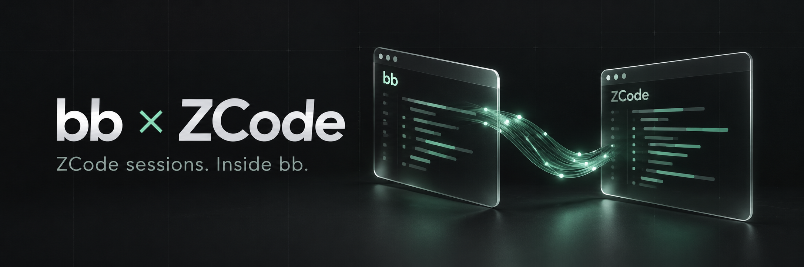
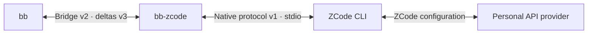

<p align="center">
  
</p>

<h1 align="center">ZCode, inside bb.</h1>

<p align="center">
  A local provider plugin for streaming replies, native tools, and resumable coding sessions.
</p>

<p align="center">
  <a href="https://github.com/dpolishuk/bb-zcode/actions/workflows/ci.yml"></a>
  <a href="LICENSE"></a>
  <a href="#compatibility"></a>
  <a href="https://www.typescriptlang.org/"></a>
</p>

<p align="center">
  <a href="#quick-start">Quick start</a> ·
  <a href="#features">Features</a> ·
  <a href="docs/configuration.md">Configuration</a> ·
  <a href="docs/validation.md">Validation</a> ·
  <a href="CONTRIBUTING.md">Contributing</a>
</p>

Bring [ZCode](https://github.com/zai-org/ZCode)'s agent into
[bb](https://github.com/get-bb/bb). Choose **ZCode** in a thread, send a prompt,
follow its work, and return to the same conversation later. The plugin runs
your installed ZCode CLI and uses its existing provider configuration.

> [!NOTE]
> Supports **individual Coding Plan sign-in in ZCode Desktop** (Z.ai / BigModel)
> and **personal API providers configured in ZCode**. Start Plan and Team plans
> are not supported yet.

## Features

|                        | What you get                                           |
| ---------------------- | ------------------------------------------------------ |
| **Live conversations** | Stream text and reasoning directly into bb.            |
| **Native tools**       | Follow ZCode tool calls and results in the thread.     |
| **Human decisions**    | Answer approvals and questions through bb.             |
| **Session continuity** | Stop, release, and resume saved conversations.         |
| **Model discovery**    | Choose from ZCode's models and reasoning options.      |
| **Plan mode**          | Ask ZCode to inspect the workspace and prepare a plan. |

Each thread runs its own supervised ZCode process. The plugin reads ZCode's
existing sign-in and keeps short-lived Coding Plan credentials in memory;
there are no API-key settings to fill in or credentials to paste into bb.

## Quick start

You'll need **bb 0.46.1**, **Node.js 24+**, and a local **ZCode** installation
with individual Coding Plan connected in ZCode Desktop or a personal API provider
configured. Start bb before installing the plugin.

### Install from bb's marketplace

Open **Settings → Plugin marketplaces**, paste this into **Marketplace source**, and
click **Add**:

```text
https://raw.githubusercontent.com/dpolishuk/bb-zcode/main/marketplace.json
```

In bb's plugin store, search for **ZCode**, open the entry from **ZCode for bb**,
and click **Install**. bb downloads, builds, and manages the plugin for you.
Adding the marketplace alone does not install a plugin.

You can also paste this Git source into the same field:

```text
git:https://github.com/dpolishuk/bb-zcode.git@main
```

The plain `https://github.com/dpolishuk/bb-zcode` repository page is not a
marketplace manifest; bb 0.46.1 requires the raw JSON URL or `git:` source above.

With the bb CLI on PATH, the equivalent is:

```sh
bb marketplace add git:https://github.com/dpolishuk/bb-zcode.git@main
bb plugin install zcode@bb-zcode
```

The catalog and plugin track `main`. Use bb's native update controls or
`bb plugin update zcode` to install later compatible changes. See
[marketplace details](docs/marketplace.md) for refresh and verification.

### Install from a checkout

For local development:

```sh
git clone https://github.com/dpolishuk/bb-zcode.git
cd bb-zcode
npm ci --ignore-scripts
npm run check
node scripts/bb.mjs plugin install . --yes
```

Open a new bb thread, select **ZCode**, choose a model, and send a prompt.

### Updating for Coding Plan support

On the machine running bb, sign in to ZCode Desktop and open **Coding Plan**
once, then update the plugin and open a new bb thread:

```sh
bb plugin update zcode --yes
bb provider models zcode --json
```

The list should contain actual model names and their supported effort choices.
For example, the verified ZCode catalog exposes GLM-5.3 / GLM-5.3-Flash with
`low`, `high`, and `max`. Choices follow your installed ZCode catalog.

The installer helper uses bb's installed macOS app CLI, or `bb` on PATH on
other systems. The provider finds `zcode` on PATH, then tries the CLI bundled
in `/Applications/ZCode.app`.

<details>
<summary><strong>Using a custom ZCode or Node installation?</strong></summary>

Set the paths on the machine running your bb threads:

```sh
node scripts/bb.mjs plugin config zcode set executable /absolute/path/to/zcode.cjs
node scripts/bb.mjs plugin config zcode set nodeExecutable /absolute/path/to/node
node scripts/bb.mjs provider models zcode
```

See [configuration](docs/configuration.md) for launch arguments, environment
overrides, permission modes, and troubleshooting.

</details>

## Compatibility

| Component     | Tested with                 |
| ------------- | --------------------------- |
| bb            | 0.46.1                      |
| bb plugin SDK | 0.6.49                      |
| ZCode CLI     | 0.16.9 · native protocol v1 |
| Platform      | macOS                       |
| CLI runtime   | Node.js 24 and 26.5.0       |

**20 automated tests** cover the bridge contract, streaming, approvals,
questions, cancellation, resume, and transport failures. An end-to-end check
also passed through **bb → this plugin → the real ZCode CLI**, using a
deterministic local model fixture.

See the [validation record](docs/validation.md) for what was tested and what
remains unverified. Personal provider authentication and production model
connectivity have not been tested. Linux and Windows launch support is
implemented but has not received the same live verification.

### Current scope

- Tool activity appears as generic tool rows; rich diffs and usage billing are
  not exposed yet.
- Attachments, live steering, forks, manual compaction, and archive/rename
  mirroring are not implemented.
- bb-injected tools and skill-root configuration are not forwarded. ZCode's
  native tools remain available.
- ZCode labels this session API as legacy while migrating its desktop protocol.
  Future CLI versions may require adapter changes.

## How it works



The adapter translates the two protocols, supervises child processes, and
forwards native approval requests to bb. bb instructions are prepended to the
first prompt and retained in ZCode's saved conversation.

## Development

```sh
npm run check         # TypeScript, tests, and bb's plugin builder
npm run format:check  # Formatting
npm run test:live     # Installed ZCode CLI + isolated loopback model
```

The live test uses an isolated HOME and synthetic provider configuration. It
does not use your model credentials. CI runs the static checks and synthetic
test suite; the native CLI smoke is opt-in.

`marketplace.json` is generated from the package branding and
`PLUGIN_OVERVIEW.md`. Run `npm run marketplace:build` after changing either;
CI checks that the committed catalog stays in sync.

Contributions are welcome. Start with [CONTRIBUTING.md](CONTRIBUTING.md) and the
[configuration guide](docs/configuration.md).

## License and credits

[MIT](LICENSE) © 2026 Dmitry Polishuk.

Built on the public [bb plugin SDK](https://github.com/get-bb/bb) and
[ZCode's native protocol](https://github.com/zai-org/ZCode).
This is an independent community integration, not an official bb or ZCode plugin.
